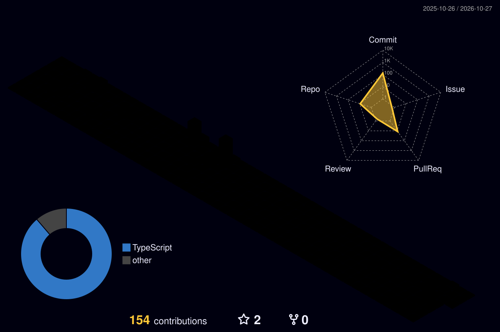

 

  

---

### 🧑‍💻 About

- 🎓 400-level Software Engineering @ **Babcock University**
- 🎨 Front-end obsessed: clean, fast, animated interfaces
- 🌍 Building software with **real social impact**
- 🔥 Doing **100 Projects in 100 Days**
- 🎯 Goal: **Software Engineering Team Lead at Google**

### ⚡ Tech Stack

### 🧊 3D Contribution Graph

### 📊 Stats

### 🚀 Featured Projects

| Project | What it is |
|---|---|
| [**Rycorn**](https://github.com/Ryanv20/Rycorn) | Add a one-line description |

### 🤝 Connect

